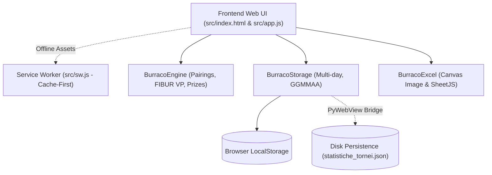

# Burraco Tournament Manager Blueprint

## System Overview

**Burraco Tournament Manager (BurracoPunti)** is an offline-first, senior-accessible tournament scoring and leaderboard management application. It automates Victory Point (VP) and Match Point (MP) computations, Mitchell table movement pairings, prizepool distribution, and exports for Burraco tournaments.

The application operates under a dual-runtime model:

1. **Desktop Native (Windows)**: Wrapped in `main.py` via `pywebview`, providing direct disk persistence to `C:\Users\[USER]\Documents\BurracoPunti\statistiche_tornei.json` and native Windows save file pickers.
2. **Web / PWA (Offline-Cached)**: Standalone Progressive Web App (`src/sw.js`) with Cache-First strategy, installable on iPad, tablet, and mobile browsers with local scoring capability.



---

## Local Interface & Invariants

### 1. Backend & Build Scripts (Root)

- **`main.py` (`BurracoAPI`)**:
  - `save_tournament_data(data_json)`: Writes tournament payload to `Documents/BurracoPunti/statistiche_tornei.json`.
  - `load_tournament_data()`: Reads JSON data from the user Documents folder.
  - `save_excel_file(filename_default, base64_content)`: Opens native Windows save dialog to persist `.xlsx` binaries.
  - `save_json_backup(filename_default, json_content)`: Opens native Windows dialog for JSON backup export.
  - _Invariants_: Window dimensions minimum 1100×750px; flags `--disable-gpu` configured for legacy Windows graphics drivers.
- **`build.py`**: PyInstaller build automation generating standalone `BurracoPunti.exe` (run manually by operator).
- **`test_engine.js`**: 21-test automated suite covering parsing, Mitchell movements, FIBUR conversions, accessibility, and offline cache consistency.

---

## Subdirectories & System Boundaries

### `src/` — Application Frontend

- **[`src/index.html`](file:///home/giorgio/Desktop/apps/BurracoPunti/src/index.html)**:
  - Single Page Application DOM structure with tabbed views: Tabellone Iniziale, Round Scoring, Classifica Generale, and Podio.
  - Custom modal dialogs: Settings, Pair Editing, Lottery Draw, Custom Tournament Name, Backup Loading, Feedback, and Confirmation.
  - Service Worker registration with online/offline connectivity listeners.

- **[`src/app.js`](file:///home/giorgio/Desktop/apps/BurracoPunti/src/app.js) (`BurracoApp`)**:
  - Central reactive UI controller coordinating DOM rendering, state updates, and user input events.
  - **Methods**:
    - `initNetworkStatus()`: Monitors online/offline events, updates Settings indicator dot, and triggers background `reg.update()`.
    - `initFontZoom()` / `applyFontZoom()`: Controls zoom scale levels (0.9 to 1.4) across `.app-main` and `.modal-dialog`.
    - `renderRoundView()`: Generates Mitchell table rows, score fields with `inputmode="numeric"`, and auto-calculates opponent VP.
    - `checkRoundScoreConsistency()`: Validates that round VP sum equals $20 \times \text{active tables} + \text{bye VP}$.
    - `showFeedbackModal({ title, message, detail, icon })`: Non-blocking alert modal replacement.
    - `showConfirmModal({ title, message, detail, confirmText, confirmClass, onConfirm, onCancel })`: Non-blocking confirmation modal replacement.

- **[`src/sw.js`](file:///home/giorgio/Desktop/apps/BurracoPunti/src/sw.js)**:
  - Service Worker implementation caching all static assets (`burraco-cache-v1.4.2`).
  - Cache-First strategy for static assets and offline navigation fallback to cached `index.html`.

- **[`src/manifest.json`](file:///home/giorgio/Desktop/apps/BurracoPunti/src/manifest.json)**:
  - PWA manifest defining standalone display mode, orientation, app shortcuts, and icon assets.

### `src/css/` — Modular Design System

- **[`src/css/base.css`](file:///home/giorgio/Desktop/apps/BurracoPunti/src/css/base.css)**: Slate & Sapphire design tokens, typography, header controls, tabs navigation, responsive media queries (≤ 900px), and scroll locks (`overscroll-behavior: none`).
- **[`src/css/tables.css`](file:///home/giorgio/Desktop/apps/BurracoPunti/src/css/tables.css)**: Tabular styles, Mitchell pair row grouping with vertical `rowspan="2"` table number cells, and sticky headers.
- **[`src/css/modals.css`](file:///home/giorgio/Desktop/apps/BurracoPunti/src/css/modals.css)**: Custom modal backdrop animations, dialog layouts, and `--app-zoom` inheritance.
- **[`src/css/podium.css`](file:///home/giorgio/Desktop/apps/BurracoPunti/src/css/podium.css)**: 3D celebratory podium cards for 1st, 2nd, and 3rd place finishers.
- **[`src/css/print.css`](file:///home/giorgio/Desktop/apps/BurracoPunti/src/css/print.css)**: Clean A4 print layout rules for physical referee records.

### `src/js/` — Core Pure Logic Modules

- **[`src/js/config.js`](file:///home/giorgio/Desktop/apps/BurracoPunti/src/js/config.js) (`BURRACO_CONFIG`)**:
  - Single source of truth for version (`v1.4.2`), default tournament rounds (4), default bye points (12), prizepool settings, and disk folder names.
- **[`src/js/utils.js`](file:///home/giorgio/Desktop/apps/BurracoPunti/src/js/utils.js) (`BurracoUtils`)**:
  - Date formatting (`getDateGGMMAA`), HTML escaping (`escapeHtml`), and sort key parsing (`parseSortKey`).
- **[`src/js/engine.js`](file:///home/giorgio/Desktop/apps/BurracoPunti/src/js/engine.js) (`BurracoEngine`)**:
  - `getMitchellPairings(pairs, roundIndex)`: Computes Mitchell round movement pairings and resting pair designation for odd counts.
  - `calculateVpFromMp(mpA, mpB)`: Official FIBUR 11-bracket table conversion from Match Point difference to 20 Victory Points.
  - `calculatePrizepool(pairsCount, feePerPlayer, percentages)`: Computes monetary rewards rounded to 0.50€.
  - `assignRandomLots(pairs)` / `assignSequentialLots(pairs)`: Lottery assignment logic.
- **[`src/js/storage.js`](file:///home/giorgio/Desktop/apps/BurracoPunti/src/js/storage.js) (`BurracoStorage`)**:
  - `loadState()` / `saveState(state)`: Dual-layer persistence across `localStorage` and disk bridge.
  - `startNewEvening(state)`: Archives current session under `serata_GGMMAA` and resets active board.
  - `mergeBackupData(currentState, backupData)`: Non-destructive JSON backup importer with duplication protection.
- **[`src/js/excel.js`](file:///home/giorgio/Desktop/apps/BurracoPunti/src/js/excel.js) (`BurracoExcel`)**:
  - `exportLeaderboardImage(state, rankedPairs, callback)`: HTML5 Canvas rendering of the leaderboard formatted for WhatsApp sharing.
  - `exportToExcel(state, rankedPairs, callback)`: SheetJS workbook generator containing Leaderboard and Complete Rounds sheets.

---

## Global Invariants

1. **Date Key Schema**: Evening archives must strictly follow `serata_GGMMAA` (e.g. `serata_281026` for October 28, 2026) to preserve session state past midnight.
2. **Score Range Constraint**: Individual Victory Points are clamped between $0 \le \text{VP} \le 20$.
3. **Complementary Scores**: For any active pairing $A$ vs $B$, $\text{VP}_A + \text{VP}_B = 20$.
4. **Modal Hygiene**: Zero native blocking dialogs (`window.alert`, `window.confirm`). All dialogs must use the application modal subsystem.
5. **Senior Visual Accessibility**: Touch hit areas must adhere to minimum ergonomic bounds (≥ 34–36px); font zoom must scale both tables and modal overlays.

---

## Global Side Effects

- **Desktop Disk Persistence**: Synchronous / asynchronous writes to `statistiche_tornei.json` in user's Documents folder.
- **Browser LocalStorage**: Local mutations under key `burraco_master_state` and `burraco_zoom_index`.
- **PWA Cache Invalidation**: Deletion of previous cache versions during Service Worker `activate` event lifecycle.

---

## System Verification

Execute the complete modular verification suite:

```bash
node test_engine.js
```
